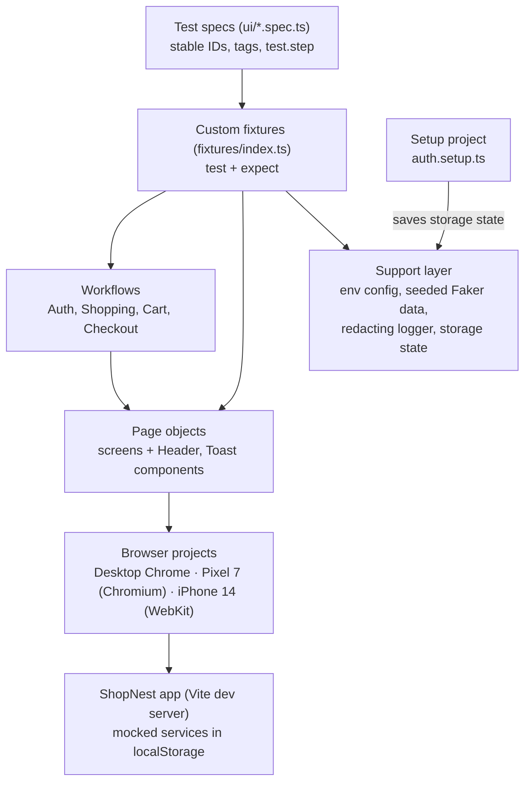

# ShopNest – E-commerce Test Automation Framework

An end-to-end test automation framework built with Playwright Test and TypeScript. It validates e-commerce workflows across desktop and emulated mobile browsers.

## Project Overview

ShopNest is a React + Vite demo store with mocked services. Accounts, sessions, carts and orders live in the browser's `localStorage`, and the only payment method is a simulated Cash on Delivery. There is no real backend or payment gateway.

The framework under `tests/playwright/` validates sign-up and sign-in, search, product browsing, cart, checkout, navigation and mobile layouts. It uses a layered design (specs → fixtures → workflows → page objects) so that locators and business steps live in one place and specs stay readable.

## Technology Stack

| Area | Technology |
|---|---|
| Language | TypeScript |
| Automation | Playwright Test |
| Application | React, React Router, Vite |
| Test data | Faker.js (`@faker-js/faker`) |
| Containerisation | Docker (official Playwright image) |
| CI/CD | GitHub Actions |
| Test management | Dependency-free Node.js test catalogue (`test-manager/`) |

## Framework Architecture



| Layer | Responsibility |
|---|---|
| Test specs | Scenarios with stable IDs (e.g. `CHK-UI-013`), tags (`@smoke`, `@mobile`, …) and numbered `test.step` blocks. |
| Custom fixtures | One `test`/`expect` export that injects page objects, workflows, seeded test data and a per-test logger. |
| Page objects | Locators and UI interactions per screen, plus reusable `HeaderComponent` and `ToastRegion`. |
| Workflows | Business operations composed from page objects; each waits for the resulting app state. |
| Support | Environment config, storage-state presets, `localStorage` readers, layout checks, redacting logger. |

## Framework Features

| Feature | Implementation |
|---|---|
| **Page Object Model** | One class per screen in `pages/` (login, register, listing, product, cart, checkout, confirmation, orders) plus header and toast components. Specs never declare raw locators; they use `data-testid` via page objects. |
| **Workflow layer** | `AuthWorkflow`, `ShoppingWorkflow`, `CartWorkflow` and `CheckoutWorkflow` combine page objects into business steps and synchronise with web-first assertions (for example, sign-up resolves once the header greets the new user). |
| **Custom fixtures** | `fixtures/index.ts` extends Playwright's `test`. Specs request what they need (`async ({ cart, checkoutPage, data, log }) => …`) and Playwright builds it lazily for that test only. |
| **Authentication state** | A `setup` project signs in the seeded Demo User through the real login form and saves the storage state. Desktop and mobile projects depend on it. Tests start signed out and opt in with `test.use(signedIn)`. |
| **Test data** | A Faker instance per test, seeded from the test title or from `FAKER_SEED`, so data is reproducible. The seed is written to the test log. Builders create unique registration users and Indian shipping addresses. |
| **Mobile emulation** | `mobile-chrome` (Pixel 7, Chromium) and `mobile-safari` (iPhone 14, WebKit) run `@mobile` tests with touch input. These are Playwright device profiles, not physical devices. Optional desktop Firefox/WebKit via `PW_CROSS_BROWSER=true`. |
| **Isolation and parallelism** | Every test gets a new browser context, and all app state lives in that context's `localStorage`. Tests set up their own preconditions, so they run `fullyParallel` against one dev server. |
| **Logging and reporting** | HTML and JSON reports; screenshots, videos and traces kept for failures. A per-test log (`test-log.txt`) is attached to the report, with sensitive keys such as passwords and tokens redacted. `report:summary` prints pass/fail per project. |
| **Docker** | A self-contained image based on the official Playwright image. Credentials are passed at runtime with `--env-file` and are never baked in. |
| **CI/CD** | Smoke tests on every pull request and push to `main`; a sharded regression run with merged HTML/JSON reports and uploaded artifacts. |

## Project Structure

```text
e-commerce_automation/
├── src/                          # ShopNest React application (seed data in src/data/)
├── public/
├── tests/playwright/
│   ├── config/env.ts             # the only reader of environment variables
│   ├── fixtures/                 # custom test/expect
│   ├── pages/                    # page objects and components
│   ├── workflows/                # business workflows
│   ├── support/                  # auth state, localStorage readers, logger, layout checks
│   ├── test-data/                # Faker builders, product and checkout constants
│   ├── setup/auth.setup.ts       # signs in once and saves storage state
│   ├── ui/                       # specs: auth, srch, prod, cart, chk, nav, mobile
│   ├── scripts/                  # summarize-results.mjs
│   ├── .env.example
│   └── playwright.config.ts
├── test-manager/                 # test case catalogue (web UI + CLI)
├── .github/workflows/            # smoke.yml, regression.yml
├── Dockerfile
└── package.json
```

## Prerequisites

| Requirement | Needed for |
|---|---|
| Node.js 20.19+ or 22.12+, npm 10+ | Required |
| Git | Required |
| Chromium and WebKit (installed by Playwright) | Required |
| Docker | Optional: containerised runs only |

## Installation and Setup

```bash
# 1. Clone (any directory)
git clone https://github.com/Ak79p/e-commerce_automation.git
cd e-commerce_automation

# 2. Install application dependencies (repository root)
npm ci

# 3. Install test dependencies (tests/playwright)
cd tests/playwright
npm ci

# 4. Install browsers (tests/playwright)
npx playwright install chromium webkit                # macOS / Windows
npx playwright install --with-deps chromium webkit    # Linux (also installs OS packages)

# 5. Create the test environment file (tests/playwright)
cp .env.example .env

# 6. Verify: list every discovered test (tests/playwright)
npm run test:list
```

From the repository root, step 5 is `cp tests/playwright/.env.example tests/playwright/.env`. In `.env`, set `TEST_USER_EMAIL` and `TEST_USER_PASSWORD` to the seeded Demo User account (`USR-0001` in `src/data/users.ts`). All other settings (`BASE_URL`, `PW_WORKERS`, `FAKER_SEED`, `PW_LOG`, …) have working defaults. `.env` is git-ignored; never commit it.

You don't need to start the app. Playwright's `webServer` runs `npm run dev` on port 5173, or reuses a server that is already running (`PW_START_SERVER=false` disables this).

## Running Tests

Run all commands from `tests/playwright/`.

| Purpose | Command |
|---|---|
| Full regression (desktop + both mobile projects) | `npm test` |
| Smoke suite (`@smoke` tag, desktop + mobile) | `npm run test:smoke` |
| Desktop Chrome only | `npm run test:desktop` |
| Mobile emulation only (Pixel 7 + iPhone 14) | `npm run test:mobile` |
| Headed desktop run, one worker | `npm run test:headed` |
| Debug with Playwright Inspector | `npm run test:debug -- --grep CHK-UI-013` |
| Playwright UI mode | `npm run test:ui-mode` |
| List tests | `npm run test:list` |
| TypeScript check | `npm run typecheck` |
| Open the HTML report | `npm run report` |
| Pass/fail summary per project | `npm run report:summary` |

To run one test case by its stable ID: `npx playwright test --grep CHK-UI-013`.

## Reports and Debugging

```text
tests/playwright/artifacts/
├── html-report/      # open with: npm run report
├── results.json      # machine-readable results
├── test-results/     # screenshots, videos and traces of failed tests
└── .auth/            # saved Demo User session from the setup project (keep private)
```

To inspect a failed test's trace: `npx playwright show-trace artifacts/test-results/<test-folder>/trace.zip`. Traces are also linked from the HTML report. Set `PW_ARTIFACTS_DIR` to write a run's output elsewhere.

## Docker Execution

Run from the repository root after creating `tests/playwright/.env`. Reports are written to `./artifacts` on the host.

```bash
docker build -t shopnest-tests .

# Smoke suite (the image's default command)
docker run --rm --env-file tests/playwright/.env -v "$(pwd)/artifacts:/app/tests/playwright/artifacts" shopnest-tests

# Full regression
docker run --rm --env-file tests/playwright/.env -v "$(pwd)/artifacts:/app/tests/playwright/artifacts" shopnest-tests npm test
```

In PowerShell, replace `$(pwd)` with `${PWD}`. In Git Bash on Windows, prefix the command with `MSYS_NO_PATHCONV=1` and use `$(pwd -W)`.

## CI/CD – GitHub Actions

| Workflow | Trigger | What it does |
|---|---|---|
| `smoke.yml` | Pull requests, pushes to `main`, manual | Runs `npm run test:smoke` on desktop and mobile projects, writes a per-project summary to the job, and uploads the report and failure artifacts (excluding the saved session). |
| `regression.yml` | Pushes to `main`, manual | Runs `npm test` in parallel shards (4 by default, configurable on manual runs), merges the blob reports into one HTML/JSON report, and uploads the merged report and per-shard failure artifacts. |

Both workflows require the repository secrets `TEST_USER_EMAIL` and `TEST_USER_PASSWORD` and fail early if they are missing.

## Test Case Manager

`test-manager/` is a local, dependency-free web app and CLI for the test catalogue in `test-manager/data/catalogue.json`. Each case has a permanent ID (for example `CART-UI-003`) that matches the spec title, which links the catalogue to the automated test. You can search and filter cases, view the full procedure, and track automation status and latest results.

```bash
cd test-manager
npm start                                       # http://127.0.0.1:5180
node scripts/case.mjs placement CART-UI-001     # spec file, tags and run command for a case
```

See [`test-manager/README.md`](test-manager/README.md) for the API and data model, and [`tests/playwright/README.md`](tests/playwright/README.md) for framework conventions.

## Future Improvements

- Automate the catalogue cases still marked `planned`.
- The catalogue schema already supports API (Playwright) and Performance (k6) layers, but no API or k6 suites exist yet.
